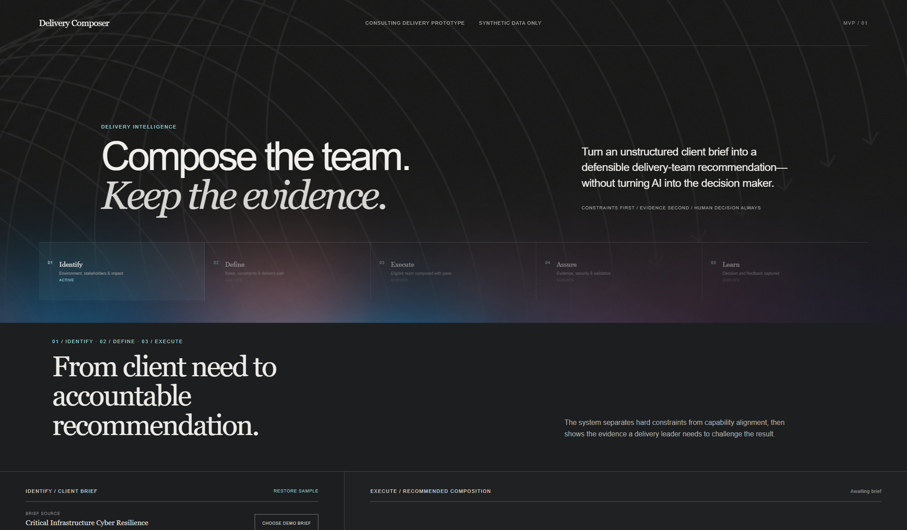

# Delivery Composer

An evidence-backed staffing MVP for consulting delivery teams. Delivery Composer turns an unstructured client brief into validated requirements, applies non-negotiable constraints, retrieves relevant experience, and leaves the final decision with a human delivery leader.



## Why this exists

Consultancies often know the experience they need but cannot consistently turn a brief into a defensible team recommendation. This MVP demonstrates a safer division of labor:

1. AI structures ambiguous requirements.
2. PostgreSQL enforces hard constraints.
3. pgvector ranks semantically relevant experience.
4. The interface exposes evidence and exceptions.
5. A person approves or revises the recommendation.

> **Rules first. Semantic retrieval second. Human decision always.**

## IDEAL methodology alignment

The product journey mirrors [C86's IDEAL methodology](https://www.c86.tech/methodology) while keeping the existing operations-tool interface:

1. **Identify** captures the client environment, stakeholders, intended outcome, and highest-impact need.
2. **Define** turns that opportunity into roles, skills, clearance, and a delivery path.
3. **Execute** composes an eligible team using deterministic rules or the configured PostgreSQL/pgvector path.
4. **Assure** exposes constraint checks and evidence for a human delivery leader to validate.
5. **Learn** records the decision and optional reviewer notes for later refinement.

The stage strip reflects the real workflow state. In deterministic preview mode, Learn feedback is retained only for the current API process lifetime and is labeled `session`. When the live database and Gemini path are both configured, compositions and reviews are stored in PostgreSQL and labeled `postgres`. Neither path claims autonomous model training.

## Demo brief library and PDF-ready boundary

Today's meeting interface opens a backend-served library of three synthetic client briefs. Selecting one loads its editable text, reference, and sector into the same evaluator used by manual entry. This keeps the walkthrough quick and repeatable without implying that real client documents are being processed.

The FastAPI service retains a bounded PDF extraction adapter for a greenlit version: one `.pdf`, `application/pdf`, valid PDF signature, at most 2 MiB and five pages, no encryption, and searchable text only. The endpoint does not persist uploaded bytes or extracted text, but it is not exposed by today's meeting UI.

Three polished synthetic briefs are available under [`output/pdf/`](output/pdf/README.md):

- Critical infrastructure cyber resilience -> Theo Morgan, Maya Patel, Amina Okafor.
- Financial services AI governance -> Theo Morgan, Amina Okafor, Elena Rossi.
- Media and broadcast platform recovery -> Theo Morgan, Jon Bell, Elena Rossi.

These cases produce different titles, skills, sectors, target dates, roles, summaries, and ordered teams in deterministic preview mode. Regenerate the PDFs with `scripts/generate_mock_briefs.py`.

## Candidate comparison and human override

The synthetic roster contains fifteen fictional profiles: three exact-role candidates for each of the five role families used across the demo. Opening a recommendation shows both runners-up and their alignment scores. Selecting either runner-up opens a focused current-versus-challenger comparison with the score delta, server-computed scoring arithmetic, positive evidence, considerations, clearance, and availability arranged like an RPG equipment comparison while retaining the restrained C86 visual system.

Deterministic meeting scores are fully attributable: `58` points for exact role fit, `8` per required-capability match, and `5` per preferred-sector match, capped at `97`. The comparison names the component responsible for every delta and proves that the displayed total equals the returned components. Narrative considerations, clearance, and availability are explicitly labeled as not scored; the latter two remain eligibility gates that can outrank a higher alignment score.

The service recommends only a candidate who passes the hard gates. A delivery leader can still select another candidate, including one with a clearly labeled exception, to demonstrate the real governance boundary. That override is validated against the composition run and carried into the final review record; recomposing or changing the brief clears it.

## Actionable review and revision

Approval and revision are real API decisions rather than decorative buttons. Approval exposes working actions to change the decision or begin another evaluation. A revision request requires actionable feedback, records that review, and exposes `Re-evaluate with feedback`. The new composition is linked to its reviewed parent run, applies the bounded feedback, and keeps an interactive prior-versus-current role and team delta in the interface.

In deterministic meeting mode, explicit instructions such as `Replace the Data & AI Engineer with a Cloud Engineer` materially change the requested role set without making a paid model call. The live adapter supplies the same bounded revision context to Gemini and pgvector while keeping credentials server-side.

## What the demo proves

- A realistic client brief can be converted into a three-person delivery recommendation.
- Every proposed consultant is accompanied by the evidence and hard-constraint checks used to support the match.
- Every requested role exposes three distinct candidates with visible positives and trade-offs.
- A human can override the recommendation without hiding a failed constraint, and that decision is captured in the review.
- A revision request produces a linked re-evaluation and an inspectable prior-result delta instead of a terminal disabled state.
- AI-generated reasoning is advisory and cannot bypass clearance or availability rules.
- The same interface supports a deterministic, no-cost preview and the configured PostgreSQL/pgvector + Gemini path.
- The public-facing concept uses synthetic people and engagement data only.

## Architecture

Today's meeting build deliberately runs the no-cost deterministic path:

```text
React -> FastAPI -> deterministic requirements and ranking -> API-session review storage
```

The same FastAPI service owns the planned live adapters:

```text
React + Firebase Hosting
          |
          | /api/* rewrite
          v
FastAPI on Cloud Run ---- Gemini API (server-side only)
          |
          v
Aiven PostgreSQL + pgvector

Demo library -> typed FastAPI response -> editable brief text
Future PDF -> FastAPI validation + pypdf extraction -> same brief contract
```

`DEMO_MODE=true` is an enforced execution boundary: PostgreSQL and Gemini adapters are not initialized even if credentials happen to exist. The live path is enabled only by setting `DEMO_MODE=false` with both server-side credentials; incomplete live configuration fails at startup instead of silently producing a hybrid result. See [`docs/TODAYS_DEMO.md`](docs/TODAYS_DEMO.md) for the meeting walkthrough and upgrade boundary.

The browser never receives the Aiven connection URI or Gemini API key. FastAPI validates the brief, bounds request size, and owns all database and model-provider access.

## Repository map

```text
api/                    FastAPI service, domain logic, migration, seed, tests
web/                    React/Vite client and C86-aligned visual system
docs/                   Architecture handoff, visual criteria, QA evidence
.codex/verify.json      Canonical local verification contract
.github/workflows/      Pull-request and main-branch CI
firebase.json           Hosting and Cloud Run rewrite configuration
```

## Run locally

1. Create a virtual environment and install API dependencies:

   ```powershell
   python -m venv .venv
   .\.venv\Scripts\python.exe -m pip install -r api\requirements.txt -r api\requirements-dev.txt
   ```

2. Install frontend dependencies:

   ```powershell
   npm.cmd --prefix web ci
   ```

3. Start the API in deterministic preview mode. This path makes no paid model calls:

   ```powershell
   .\.venv\Scripts\python.exe -m uvicorn app.main:app --app-dir api --reload --port 8000
   ```

4. Start the frontend:

   ```powershell
   npm.cmd --prefix web run dev
   ```

Open `http://127.0.0.1:5173` and run the populated sample brief.

## Deploy the deterministic demo

The reviewed meeting deployment uses Firebase project `composermvp-4d5c0`, Cloud Run service `delivery-composer-api` in `us-east1`, and the eventual custom domain `composer.jamesai.space`. It keeps `DEMO_MODE=true`; PostgreSQL and Gemini credentials are neither required nor configured.

After the deployment PR is merged, Blaze billing is active, a budget alert is verified, and both CLIs are authenticated, deploy from a clean `main` branch:

```powershell
powershell -ExecutionPolicy Bypass -File scripts\deploy-demo.ps1 -BudgetAlertConfirmed
```

The script runs the canonical verifier, deploys Cloud Run with zero minimum and one maximum instance, verifies the credential-free health contract, deploys Firebase Hosting, and verifies the `/api/**` rewrite. See [`docs/DEPLOYMENT.md`](docs/DEPLOYMENT.md) for preconditions, custom-domain setup, rollback, and known limitations.

## Enable PostgreSQL, pgvector, and Gemini

Copy `.env.example` to `.env` and add the real values locally. Never commit `.env`, a database URI, or a model API key.

After `DATABASE_URL` and `GEMINI_API_KEY` are available server-side, set `DEMO_MODE=false` and run:

```powershell
Push-Location api
..\.venv\Scripts\python.exe -m app.migrations
..\.venv\Scripts\python.exe -m app.seed
Pop-Location
```

`migrations.py` enables pgvector and creates the schema. `seed.py` generates embeddings for the fifteen-profile synthetic roster.

## Verification

Run the same required checks used by the repository contract:

```powershell
.\.venv\Scripts\python.exe -m ruff check api
.\.venv\Scripts\python.exe -m pytest api\tests
npm.cmd --prefix web run build
```

The visual workflow is also checked at desktop and mobile widths for PDF extraction, composition, evidence expansion, IDEAL stage transitions, review recording, console errors, unintended overflow, and the animated trajectory field. See [`docs/design-qa.md`](docs/design-qa.md) and [`docs/pdf-qa.md`](docs/pdf-qa.md).

## Current boundary

This repository is a **public-low-risk demo implementation using synthetic data**, not a production staffing or hiring decision system. The deterministic hosted path requires the documented billing safeguards and deployment smoke tests. PostgreSQL and Gemini remain a separate, disabled path that still requires server-side secrets and live integration verification. Do not load real client, candidate, or employee information into this MVP.

The interface is a tailored concept for a C86 conversation. It is not an official C86 product and does not claim C86 endorsement or ownership.
